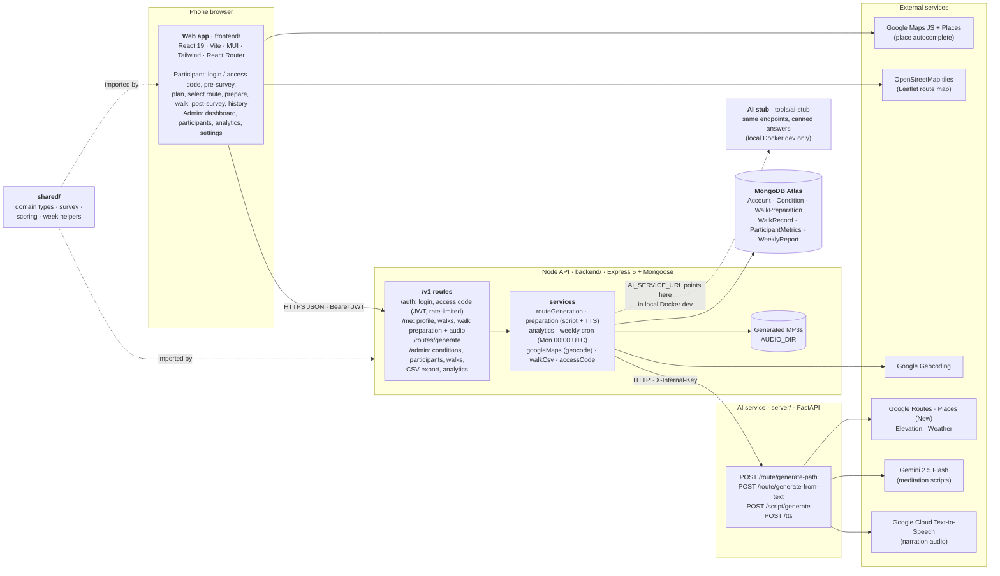
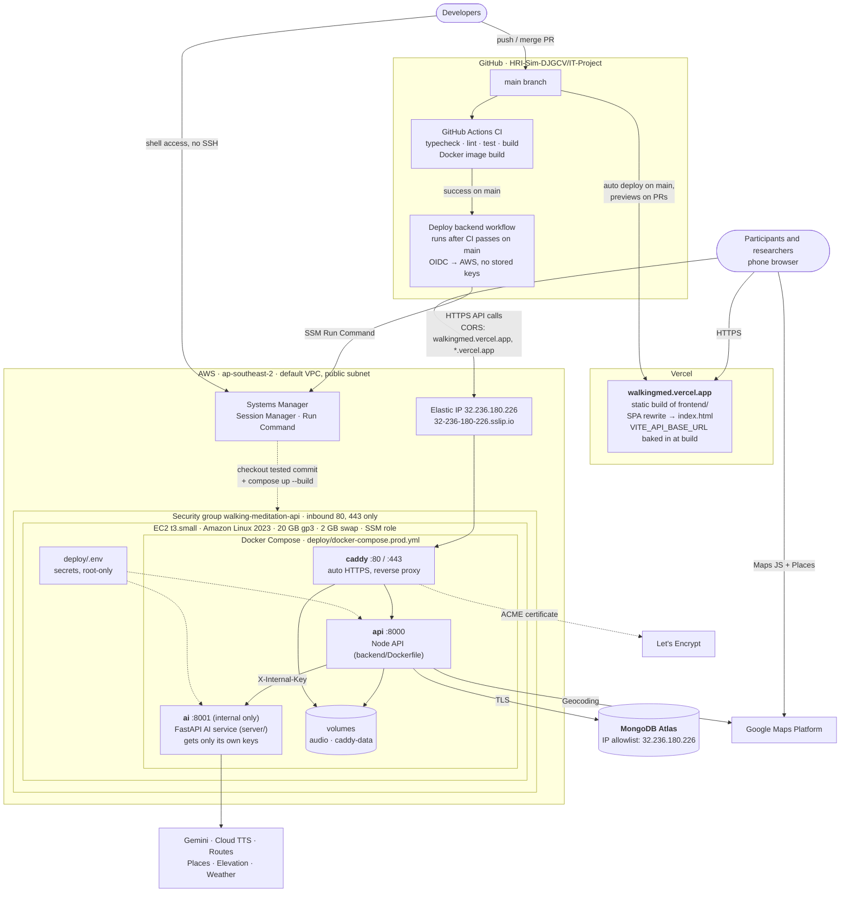

# Architecture

State of `main` as of 2026-10-20. Both diagrams are Mermaid, which GitHub renders.

## System architecture

How the code is organised and what talks to what.

**Notes**

- The Node API is the only entry point for the app. The AI service is internal and is never called by the browser.
- The AI service requires an `X-Internal-Key` header on every route except `/health`.
- `shared/` is compiled into both the web app and the API, so survey questions and scoring can't drift apart.
- Local `docker-compose.yml` uses the AI stub by default; `docker-compose.real.yml` swaps in the real service.

## Deployment

What runs where in production today.

**Notes**

- Vercel redeploys the frontend on every merge to `main`. The backend redeploys automatically once CI passes on `main`: `.github/workflows/deploy-backend.yml` signs in to AWS with OIDC and uses SSM to check out the exact commit CI tested and rebuild the containers. It skips the rebuild if nothing under `backend/`, `server/`, `shared/` or `deploy/` changed, skips with a warning if the instance is stopped, and finishes with a health check on `/v1/health`. Manual steps are in [deploy/README.md](../deploy/README.md).
- The AI service container receives only the keys it needs (Google Maps, Gemini, TTS, internal key), never the database or JWT secrets.
- The AWS account is on the free plan, with $100 in credits that expire 2027-04-09, so only free-tier instance types can be used.
- The real AI service runs in production. It calls hosted Gemini and Google Cloud Text-to-Speech instead of running a local TTS model, so it fits on the t3.small.
